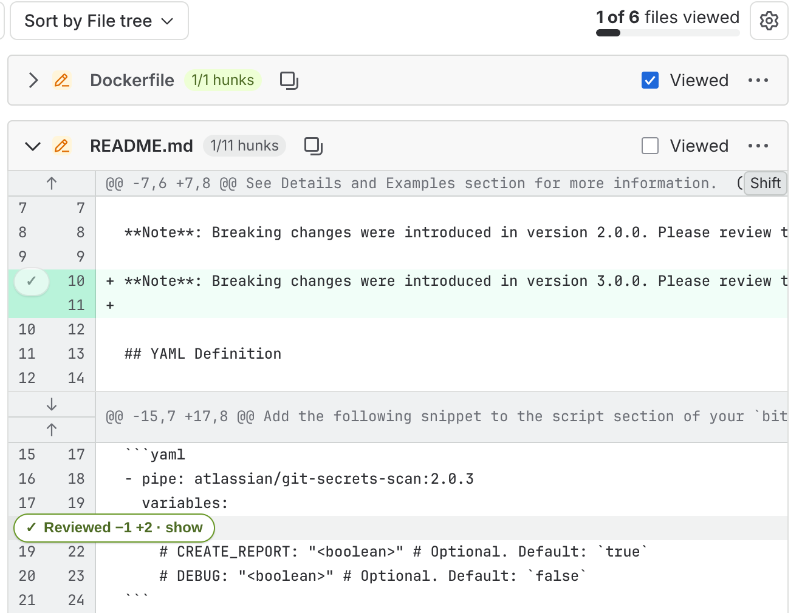
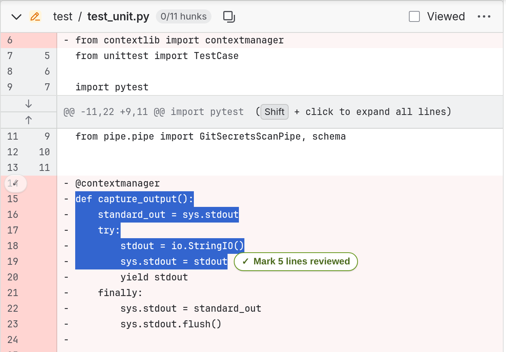
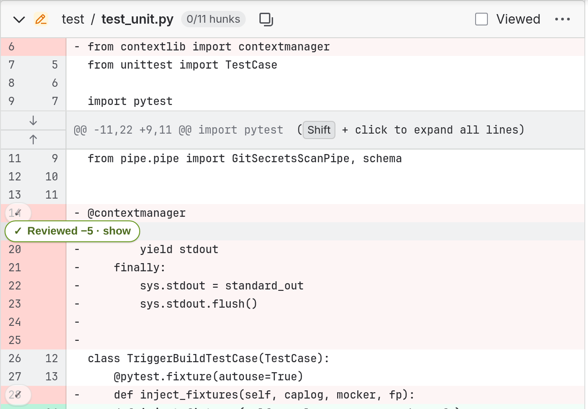
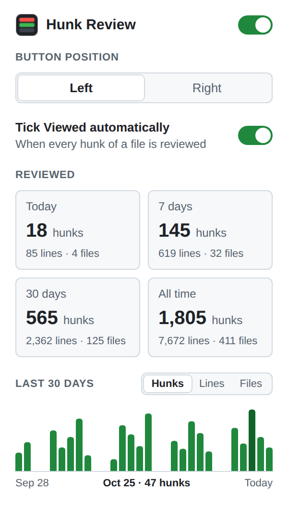

# Diff Hunk Review

**English** · [Русский](README.ru.md)

A Chrome extension for code review on GitHub and Bitbucket Cloud: hide each block of changes once you have reviewed it, like `stage hunk` in your editor. In a large pull request you only see what is still left to review.



| Select lines to mark only them | The selected lines collapse |
| --- | --- |
|  |  |



The screenshots are taken on Bitbucket Cloud; on GitHub the extension looks the same.

## Why use it

- **Review big PRs in pieces.** GitHub's **Viewed** works only for whole files. This extension lets you check off a 600-line file one hunk at a time and come back to it later.
- **Nothing gets lost.** Progress is saved per PR. A hunk that a new commit changes, or that moves elsewhere, shows up again by itself.
- **See your progress.** Every file shows `2/5 hunks`, and the popup counts what you reviewed today, this week, this month and all time.
- **Stays out of the way.** No sign-in and no setup. It adds one small button per hunk and leaves the rest of GitHub as it was.

## Features

- **Hunks.** A hunk is a block of consecutive changed lines. Blue `@@` rows and unchanged context lines are left alone.
- **Mark reviewed.** A floating **✓** button sits on the first line of each hunk, on the left over the line numbers (or on the right, see settings). Hover it to see **Mark reviewed**. A click collapses the hunk into one grey line, `✓ Reviewed −6 +3 · show`. Click that button to bring the hunk back.
- **Line by line.** Select lines with the mouse, even inside one huge hunk such as a new file, and a **Mark N lines reviewed** button appears next to the selection. The selected changed lines collapse into one grey line with its own **show** button. A hunk counts as reviewed once all its lines are, and its own button then marks only the lines that are left.
- **Sticky button for long hunks.** When a hunk's first line scrolls under the file header, the button follows you just below the header, so you can mark the hunk without scrolling back. The collapsed line then lands where the button was.
- **Progress per file.** A badge next to the file name, such as `2/5 hunks`.
- **Saved per PR.** State survives reloads and stays in sync between tabs open on the same PR.
- **Smart matching.** Each changed line is recognized by its text plus the two lines on each side of it, not by line numbers:
  - edits elsewhere in the file don't reset it;
  - expanding context doesn't reset it;
  - a line that changed, or was moved, shows up again, together with its immediate neighbours.
- **Popup.** Click the toolbar icon to:
  - turn the extension on or off;
  - choose the button position (left or right);
  - turn automatic Viewed on or off;
  - see how many hunks, lines and files you reviewed today, in the last 7 and 30 days, and all time;
  - see a bar chart of the last 30 days by hunks, lines or files; hover a day to see its number.
- **Ticks Viewed for you.** When you review the last lines of a file, the extension ticks the site's own **Viewed** checkbox (GitHub and Bitbucket both have one). It does this only on that action, so if you untick Viewed by hand, it stays unticked. You can turn this off in the popup.
- **Viewed counts too.** Ticking the site's own **Viewed** checkbox adds the file, plus its hunks you hadn't marked yet, to the statistics. Clearing the checkbox takes back exactly what it added.

## Security and privacy

The extension is meant to be easy to trust and quick to audit.

- **Small enough to read in one sitting.** About 1,400 lines of TypeScript in `src/`, split by responsibility (see [How it works](#how-it-works)).
- **Light.** The built extension is about 38 KB, including 23 KB of JavaScript. There is no framework and no minified third-party code inside.
- **No runtime dependencies.** `dependencies` in `package.json` is empty. Everything in `devDependencies` is used only to build, test and lint, and none of it ships in `dist/`.
- **No network requests and no telemetry.** The code has no `fetch`, `XMLHttpRequest`, WebSocket or remote scripts. It never calls the GitHub or Bitbucket API and never sends anything anywhere.
- **Acts only through the page.** The one thing it changes on GitHub or Bitbucket is the **Viewed** checkbox, which it clicks exactly as you would, after you review a file's last lines.
- **No accounts or tokens.** It doesn't ask for a GitHub token or a sign-in, and it doesn't read cookies. It works only with what is already on the page.
- **One permission.** `manifest.json` asks only for `storage`. The content script runs only on `https://github.com/*` and `https://bitbucket.org/*`. There is no background worker, no `host_permissions` and no `web_accessible_resources`.
- **Safe DOM handling.** Text is written with `textContent`, never `innerHTML`, and nothing is evaluated. Clicks synthesized by page scripts are ignored.
- **Data stays with you:**
  - hidden hunks and statistics are kept in `chrome.storage.local` on this device; PRs not opened for 30 days are deleted;
  - only the settings (on/off, button position, automatic Viewed) use `chrome.storage.sync`, so they follow your Chrome profile.
- **Hardened supply chain** for development. See [Development](#development).

## Installation

```bash
pnpm install
pnpm build
```

Then open `chrome://extensions`, turn on **Developer mode**, click **Load unpacked** and select the `dist/` folder.

## Requirements and limitations

- After the extension is updated or reloaded, tabs that were already open show a notice asking to reload the page: Chrome doesn't hand them the new version until then.
- On GitHub it works only with the new React-based "Files changed" view (`/pull/N/changes`). Signed out, GitHub serves the classic view, and the extension does nothing there.
- On Bitbucket it works with Bitbucket Cloud pull requests (`bitbucket.org/<workspace>/<repo>/pull-requests/N`), signed in or not. Bitbucket Data Center is not supported.
- Split view is covered only by unit tests on GitHub, and not supported on Bitbucket yet.
- Marking a file Viewed by any means other than clicking the checkbox, such as a keyboard shortcut, is not counted in statistics.
- Keys of hunks that a later commit changed stay in storage until the PR's entry expires.

## Development

| Command | What it does |
| --- | --- |
| `pnpm dev` | rebuilds `dist/` on changes |
| `pnpm build` | builds `dist/` |
| `pnpm typecheck` | type-checks the project |
| `pnpm test` | runs unit tests (Vitest + jsdom) |
| `pnpm lint` | lints and checks formatting (Biome) |
| `pnpm format` | fixes lint and formatting issues (Biome) |
| `pnpm icons` | renders `assets/icon.svg` into `public/icons/*.png` (needs Inkscape) |

After a rebuild, click the reload button for the extension in `chrome://extensions` and reload the PR page.

- **Commits** follow [Conventional Commits](https://www.conventionalcommits.org/). commitlint checks them in the `commit-msg` hook, and the `pre-commit` hook runs Biome on staged files. `pnpm install` sets up both hooks.
- **Dependencies** are installed with pnpm hardened against supply-chain attacks (`pnpm-workspace.yaml`):
  - only versions published at least 7 days ago;
  - no installs whose publishing trust is weaker than earlier releases;
  - no transitive dependencies from git or tarball URLs;
  - no dependency install scripts;
  - the registry and the pnpm version are pinned.

## How it works

| File | Purpose |
| --- | --- |
| `src/sites.ts` | everything that differs between GitHub and Bitbucket: selectors, rows, PR key, Viewed checkbox |
| `src/content.ts` | entry point: wires the `MutationObserver`, clicks and storage events to the controller |
| `src/controller.ts` | page logic: current PR, loading and saving state, which tables to rescan |
| `src/review.ts` | applies state to a file: collapsed lines, buttons, progress |
| `src/dom.ts` | GitHub selectors and splitting a diff table into hunks |
| `src/hunkKey.ts` | line key: file path + hash of the line and its neighbours on the same side |
| `src/selection.ts` | the button next to a text selection |
| `src/storage.ts` | per-PR state in `chrome.storage.local` |
| `src/settings.ts` | settings in `chrome.storage.sync` |
| `src/stats.ts` | daily counters and the today / 7 days / 30 days / all time summary |
| `src/popup.ts` | toolbar popup |

Both sites render the diff with React and mount files progressively. To stay out of React's way, the extension never inserts rows of its own. It sets `data-ghr-*` attributes on existing rows and adds one button to the first row of each hunk. Everything is reapplied after each re-render, and a repeated pass changes nothing.

The content script and the popup are each bundled into a single IIFE (`dist/content.js`, `dist/popup.js`) in two Vite passes, because MV3 content scripts can't be ES modules. The manifest, CSS, `popup.html` and icons live in `public/` and are copied as is.

If GitHub or Bitbucket changes its markup, look at `src/sites.ts`: all site-specific selectors live there.
